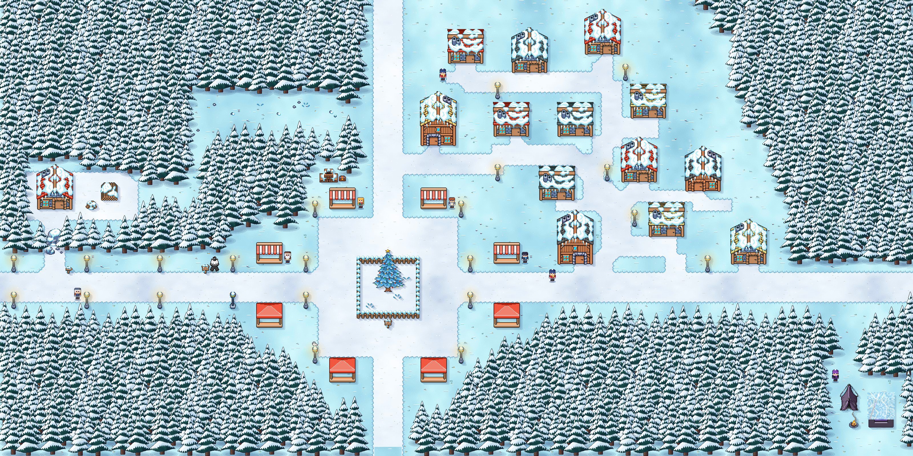

# WorkAdventure Map Starter Kit



This is a starter kit to help you build your own map for [WorkAdventure](https://workadventu.re).

To understand how to use this starter kit, follow the tutorial at [https://workadventu.re/map-building](https://workadventu.re/map-building).

## Structure
* *public*: Static files like PDFs or audio files
* *src*: Scripts files
* *tilesets*: All tilesets
* *map.tmj*: Map file
* *map.png*: The map thumbnail displayed on the in-game map information

If you want to use more than one map file, just add the new map file on root or in a folder.

we recommend using 500x500 images for the map thumbnails.

If you are going to create custom websites to embed in the map, please reference the HTML files in the `input` option in *vite.config.js*.

## Living world

The town's animation, sound and reactions are generated, not downloaded:

* `tools/map.source.json` is the map to edit in Tiled. `map.tmj` is generated from it, so changes made directly to `map.tmj` are overwritten.
* `tools/build_living_world.py` builds `map.tmj`, `map.png`, the `HS_*` tilesets, `public/audio/*.wav` and `public/portraits/*.png`, using the artwork in `tools/textures.py` and `tools/characters.py`. It needs Python with Pillow and NumPy. Run `node tools/check_map.mjs` afterwards: a map that fails the check is silently left out of the build.
* `src/living/` holds progress, sound, UI and multiplayer presence. `src/main.ts` holds the NPC conversations and world reactions.
* `overlay/` holds the NPC dialog box, the HUD and the phishing mail, which are shown as WorkAdventure UI websites.
* `office.tmj` is the stand4 side quest: find security mistakes in an office. It is generated by `tools/build_office.py` (run as part of `build_living_world.py`) and scripted in `src/office.ts`. It does not count towards the prize.

Progress is saved in the player's WorkAdventure state, so quests work without the tracking server. Prize redemption still needs it.

## Requirements

Node.js version >=17

## Installation

With npm installed (comes with [node](https://nodejs.org/en/)), run the following commands into a terminal in the root directory of this project:

```shell
npm install
npm run dev
```

## Test production map

You can test the optimized map as it will be in production:
```sh
npm run build
npm run prod
```

## Licenses

This project contains multiple licenses as follows:

* [Code license](./LICENSE.code) *(all files except those for other licenses)*
* [Map license](./LICENSE.map) *(`map.tmj` and the map visual as well)*
* [Assets license](./LICENSE.assets) *(the files inside the `src/assets/` folder)*

### About third party assets

If you add third party assets in your map, do not forget to:
1. Credit the author and license with the "tilesetCopyright" property present in the properties of each tilesets in the `map.tmj` file
2. Add the license text in LICENSE.assets
